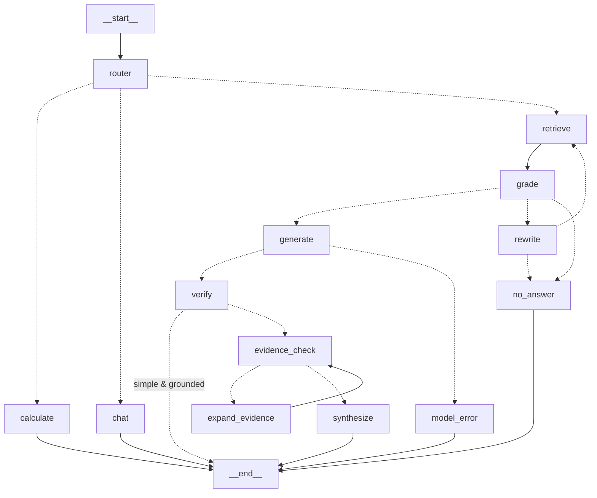

# Advanced RAG: hybrid retrieval, adaptive multi-LLM orchestration, telemetry and evaluations

A local, resource-conscious Retrieval-Augmented Generation system for Windows with 8 GB RAM, using
Ollama models only (no paid APIs). It answers questions from your PDF / DOCX / TXT documents with
**page-level citations**, **abstains** when the documents do not contain the answer, and records
**telemetry** for every request. A **reproducible benchmark** compares it against the original
pipeline.

> Upgrade of the original `rag-telemetry-evals-agentic` project. What changed and why is in
> [`docs/UPGRADE_REPORT.md`](docs/UPGRADE_REPORT.md) (audit, file-by-file changes, dependency
> reasoning, verified vs. not-yet-verified items).

---

## 1. Architecture

```
            ┌──────────── ingestion ────────────┐
 PDF/DOCX/TXT -> loader (pages) -> clean -> chunk (sentence-aware, deterministic IDs)
            -> embed (sentence-transformers | ollama | fastembed) -> ChromaDB (upsert)
                                                          └-> BM25 index (rebuilt on change)

 question -> router (rules: math / chat / retrieve + complexity: simple | complex)
          -> hybrid retrieval: dense (Chroma) + sparse (BM25) -> RRF -> dedupe -> [rerank] -> top-k
          -> grade (dense similarity OR keyword coverage) --weak--> rewrite query (bounded) -> retrieve
                                                         --none--> abstain (no LLM call)
          -> GENERATOR (cited draft) -> lexical grounding check
               simple & grounded ----------------------------------------------> answer
               complex OR ungrounded -> VERIFIER (JSON) --conflict--> wider evidence -> VERIFIER (bounded)
                                            -> SYNTHESIZER (final cited answer, or abstain) -> answer
          every node = an OpenTelemetry span; every request = one JSONL telemetry record
```

LangGraph (generated from the code with `RagAgent(...).mermaid()`):



| Module | Responsibility |
|---|---|
| `app/config.py` | Validated settings from `.env` (all tunables, role → model mapping) |
| `app/ingestion/` | `loader.py` (page-aware PDF, DOCX incl. tables, TXT, signature checks), `chunker.py`, `embeddings.py` (4 backends), `pipeline.py` (dedupe / re-index) |
| `app/retrieval/` | `vector_store.py` (Chroma + embedding-model guard), `bm25.py`, `fusion.py` (RRF), `reranker.py`, `retriever.py` (baseline `Retriever` + `HybridRetriever`) |
| `app/generation/` | `model_manager.py` (Ollama: availability, timeouts, retries, sequential lock, token/latency capture), `llm.py` (mock + legacy providers) |
| `app/agent/` | `graph.py` (LangGraph workflow), `roles.py` (generator / verifier / synthesizer prompts and parsing), `tools.py` (safe calculator) |
| `app/telemetry/` | `tracing.py` (OTel spans, request/trace IDs in logs), `metrics.py` (OTel instruments, JSONL records, summary) |
| `app/evaluation/` | `dataset.py` (versioned datasets), `scoring.py` (label-based metrics), `evaluator.py` (runner, reports, comparison) |
| `app/services.py` | Builds all components; records failures for `/ready` instead of crashing |
| `app/main.py` | FastAPI endpoints |

### Model roles
| Role | Job | Configured by |
|---|---|---|
| Generator | Draft an answer **only** from the numbered evidence, citing `[n]` | `GENERATOR_MODEL` |
| Verifier | Return JSON: verdict, unsupported claims, contradictions, conflicting evidence | `VERIFIER_MODEL` |
| Synthesizer | Keep supported claims, report conflicts, cite, or abstain | `SYNTHESIZER_MODEL` |
| Router | Query rewriting (and classification when `AGENT_ROUTER=llm`) | `ROUTER_MODEL` |

Blank role variables fall back to `OLLAMA_MODEL`, so **one model can play every role** (`/models`
reports this). Calls never run concurrently: a process-wide lock serialises generation, so an 8 GB
machine only ever has one generation in flight. `LLM_KEEP_ALIVE` asks Ollama how long to keep a
model loaded. Ollama decides when memory is actually freed; check with `ollama ps`.

---

## 2. Setup (Windows PowerShell)

```powershell
cd E:\rag-telemetry-evals-agentic

# Reuse the existing venv if it exists; create one only if it doesn't.
if (-not (Test-Path .\venv\Scripts\python.exe)) { py -3.12 -m venv venv }
.\venv\Scripts\python.exe --version          # must be 3.12.x

# If Activate.ps1 is blocked, either skip activation and call .\venv\Scripts\python.exe directly,
# or allow scripts for THIS PowerShell window only:
#   Set-ExecutionPolicy -Scope Process -ExecutionPolicy Bypass
.\venv\Scripts\Activate.ps1

python -m pip install -r requirements.txt
Copy-Item .env.example .env                  # only if you don't have a .env yet
```

### Choose an embedding backend
Run the smoke test for the backend you want:

```powershell
# A) Original (torch). If this prints WinError 4551, use B or C.
python -m pip install -r requirements-embeddings-st.txt
python -c "from app.ingestion.embeddings import Embedder; e=Embedder(backend='sentence-transformers'); print(e.model_id, len(e.embed_text('hello')))"

# B) Ollama embeddings (no Python ML packages at all)
ollama pull all-minilm
python -c "from app.ingestion.embeddings import Embedder; e=Embedder('all-MiniLM-L6-v2', backend='ollama'); print(e.model_id, len(e.embed_text('hello')))"

# C) ONNX Runtime (no torch)
python -m pip install -r requirements-embeddings-onnx.txt
python -c "from app.ingestion.embeddings import Embedder; e=Embedder(backend='fastembed'); print(e.model_id, len(e.embed_text('hello')))"
```
Set `EMBEDDING_BACKEND` in `.env` to the one that printed a vector size (384).

**Existing `chroma_db`:** your old collection was built with sentence-transformers. With backend A
it keeps working (re-upload documents to get page numbers and duplicate-safe IDs). With B or C,
set a new `CHROMA_COLLECTION_NAME` (for example `rag_documents_v2`) and re-upload. The app refuses
to mix vector spaces and never deletes the old collection.

### Choose LLMs
```powershell
ollama list                                   # what you already have
ollama ps                                     # what is loaded in RAM right now
```
Then in `.env`:
```
LLM_PROVIDER=ollama
OLLAMA_MODEL=<a model from ollama list>       # used for every role left blank
# optional: GENERATOR_MODEL=... VERIFIER_MODEL=... SYNTHESIZER_MODEL=...
```
For 8 GB RAM, small quantized models (about 1B to 4B parameters, e.g. Q4) with `LLM_NUM_CTX=2048`
to `4096` are realistic. Larger models may swap or time out. Nothing is downloaded automatically:
pick from `ollama list`, or `ollama pull` a model yourself.

---

## 3. Run

```powershell
python -m uvicorn app.main:app --reload          # API + UI at http://127.0.0.1:8000  (docs: /docs)
python -m pytest -q                              # all offline tests (mocked models)
python evaluate.py                               # baseline vs advanced comparison
python evaluate.py --mode advanced -v            # per-question output
$env:RUN_LIVE_TESTS="1"; python -m pytest tests/integration -v   # real Ollama + embeddings (opt-in)
```

Examples (PowerShell):
```powershell
Invoke-RestMethod http://127.0.0.1:8000/ready | ConvertTo-Json -Depth 6
curl.exe -F "file=@data/documents/company_policies.txt" http://127.0.0.1:8000/documents/upload
Invoke-RestMethod http://127.0.0.1:8000/query -Method Post -ContentType "application/json" `
  -Body '{"question": "How many days do I have to return a product?"}' | ConvertTo-Json -Depth 6
Invoke-RestMethod http://127.0.0.1:8000/telemetry/summary | ConvertTo-Json -Depth 6
```

### Endpoints
| Method | Path | Notes |
|---|---|---|
| GET | `/health` | Process liveness only |
| GET | `/ready` | 200/503 with per-component status: embeddings, vector store, BM25, Ollama + role models |
| GET | `/models` | Role → model, installed models, sequential-execution note |
| POST | `/documents/upload` | PDF/DOCX/TXT, size-limited, type-sniffed. Statuses: `indexed`, `reindexed`, `unchanged`, `duplicate` (legacy alias `/upload`) |
| GET | `/documents` | Indexed documents with `document_id`, chunk and page counts |
| DELETE | `/documents/{document_id}` | Removes chunks; deletes the file only with `?delete_file=true` |
| POST | `/query` | Advanced pipeline. Returns answer, `abstained`, `citations` (document + page), route, complexity, verification, steps, model calls, latencies, `request_id`, `trace_id` (legacy alias `/agent/query`) |
| POST | `/evals/run` | `{"mode": "compare"}`. One run at a time; uses an isolated index |
| GET | `/evals/results` | Latest evaluation summary |
| GET | `/telemetry/summary` | Error rate, abstention rate, routes, latency p50/p95 per stage and per model, retries, timeouts, reported tokens |

Errors always have the shape `{"error": {"code", "message", "request_id"}}`. Stack traces and file
paths go only to the server log, keyed by `request_id`.

---

## 4. Evaluation

* Dataset: `data/evaluation/eval_dataset_v2.json` (version 2.0.0, 30 questions). It contains the
  original 20 plus: PDF page questions, DOCX, two **conflicting-source** questions, comparison and
  multi-fact questions, a **prompt-injection** document, and 4 unanswerable questions. Its corpus is
  in `data/evaluation/corpus/` and is indexed into `outputs/eval_index/`, separate from your API data.
* Metrics (`app/evaluation/scoring.py`), all deterministic and label-based:
  correctness (key facts / token-F1), abstention accuracy, false-abstention rate, faithfulness
  (sentence support), answer relevance, rank-aware context precision, context recall (key facts in
  context), hit@k / source recall@k (page-aware), citation correctness, injection resistance,
  latency and error rate. Metrics that don't apply are `null` rather than counted as 1.0.
* Failure categories: `retrieval_miss`, `false_abstention`, `missed_abstention`,
  `wrong_or_incomplete_answer`, `unfaithful`, `citation_error`, `prompt_injection_followed`, `error`.
* Optional LLM judge (`--judge` or `EVAL_LLM_JUDGE=true`): stored in separate `judge_*` fields,
  labelled "not ground truth", and never mixed into the main scores.
* Reports: `outputs/evals/<timestamp>_{baseline,advanced,compare}.json|.csv` and `latest.json`. Each
  includes the dataset version and hash, the full model/retrieval config, a timestamp, per-question
  rows, aggregates, failure categories and latency stats.

**Mock vs. real runs:** with `LLM_PROVIDER=mock` the "answers" come from a deterministic sentence
picker. That checks that the pipeline works; it does not measure answer quality. Every report states
which kind of run it was.

---

## 5. Telemetry and troubleshooting

* Per request (JSONL, `TELEMETRY_LOG_PATH`): request and trace IDs, route, complexity, final source
  (generator/synthesizer/refusal), embedding/dense/sparse/rerank/retrieval latency, hit counts,
  rewrites, verifier passes, and every model call (role, model, latency, Ollama `load_duration`,
  model switch, tokens, attempts, error).
* **Measured vs. unavailable:** token counts come only from Ollama (`prompt_eval_count`,
  `eval_count`) and are `null` when not reported (`tokens_complete` says whether all calls reported
  them). Cost is always `null`, because local inference has no defensible per-token price.
* **Privacy:** question text is not logged by default (only a SHA-256 prefix and the length; enable
  with `TELEMETRY_LOG_QUERY_TEXT=true`). Document text is never written to telemetry. ChromaDB's
  anonymous usage pings are disabled.
* **Retention:** the JSONL file rotates to `.1` at 50 MB (one backup is kept). Delete old files as
  needed.
* **Traces:** `TRACE_EXPORTER=console` prints spans locally. `TRACE_EXPORTER=otlp` +
  `OTLP_ENDPOINT=http://localhost:4318/v1/traces` sends them to Jaeger, Grafana Tempo or Langfuse
  (`pip install -r requirements-otlp.txt`). No external service is required.

| Symptom | Likely cause / fix |
|---|---|
| `/ready` → embeddings error mentioning WinError 4551 | torch blocked by Windows Application Control → `EMBEDDING_BACKEND=ollama` (`ollama pull all-minilm`) or `fastembed` |
| `EmbeddingMismatchError` at startup | The collection was built with another embedding model → new `CHROMA_COLLECTION_NAME`, re-upload |
| `model_not_installed` | `ollama pull <model>` or change `*_MODEL` in `.env` |
| `ollama_unavailable` | Start Ollama (`ollama serve`, or the tray app); check `OLLAMA_BASE_URL` |
| `model_timeout`, slow answers | Smaller model, lower `LLM_NUM_CTX`/`LLM_NUM_PREDICT`, raise `LLM_TIMEOUT_S`; `ollama ps` to see what's loaded |
| Too many "I don't know" answers | Tune `AGENT_RELEVANCE_THRESHOLD` for your embedding model with `python evaluate.py`; check `relevance` in the `/query` response |
| Answers without citations | The model ignores the citation instruction → try another model; it shows up as `citation_error` in evals |
| Activate.ps1 blocked | Use `.\venv\Scripts\python.exe ...` directly, or `Set-ExecutionPolicy -Scope Process Bypass` (this window only) |

---

## 6. Security notes and limitations

* Retrieved text is fenced as `<evidence>` data, and system prompts say it must never be followed
  as instructions. Fence-closing text inside documents is neutralised. **This reduces prompt
  injection; it cannot guarantee immunity** with small local models. The eval set includes an
  injection test.
* Uploads: extension allow-list, PDF/DOCX signature check, size limit, file name sanitised
  (no path traversal), written via a temp file. The UI renders document text with `textContent`, so
  no HTML/script from documents executes. CORS is limited to localhost by default. There is **no
  authentication**: keep the API on 127.0.0.1 or put it behind an authenticating proxy.
* Scanned PDFs need OCR (not included). DOCX has no page numbers, so citations name the document only.
* The BM25 index is held in memory (term counts only) and rebuilt on every upload or delete. That's
  fine for thousands of chunks; beyond that, move it to SQLite FTS5.
* Complexity routing is rule-based and explainable, not learned. Lexical verification and
  faithfulness miss paraphrases; the LLM verifier handles meaning but is itself a small model.
* The verifier's verdicts are categorical. No component reports a "confidence probability",
  because small models' self-reported confidence is not calibrated.
* The cross-encoder reranker is optional and was **not** verified with a real model in development
  (see the upgrade report). Measure its latency in `/telemetry/summary` before enabling it on 8 GB.
# RAG_Telemetry

